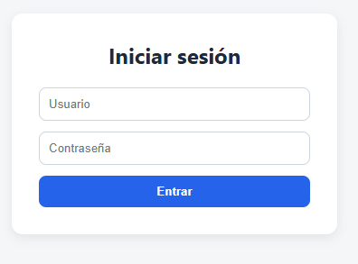
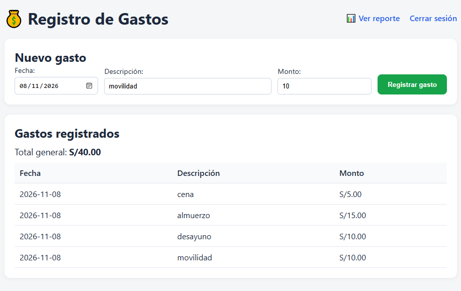
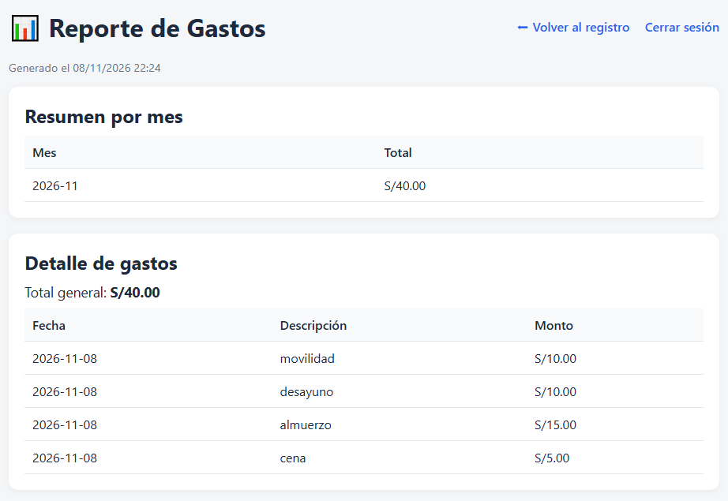

# UNIVERSIDAD PRIVADA DE TRUJILLO
# PROGRAMACION Y DESARROLLO WEB
# ALUMNO: DONATO PARIONA HUARCAYA

# 💰 Control de Gastos — Flask + SQLite

Aplicación web desarrollada en **Python con Flask y SQLite** que permite autenticarse, registrar gastos y generar reportes.

---

## 🔐 Credenciales de acceso

| Usuario | Contraseña |
|---------|-----------|
| `admin` | `123` |

---

## 📸 Capturas de la aplicación

### 1️⃣ Pantalla de inicio de sesión



### 2️⃣ Registro y listado de gastos



### 3️⃣ Reporte con resumen mensual



---

## ⚙️ Funcionamiento

1. **Inicio de sesión:** el usuario ingresa con las credenciales `admin` / `123`. Si son correctas, accede al panel principal.
2. **Registro de gastos:** el formulario solicita:
   - **Fecha** (selector de calendario)
   - **Descripción** (texto libre)
   - **Monto** (número mayor a 0)
3. **Listado:** muestra todos los gastos ordenados por fecha descendente.
4. **Reporte:** al hacer clic en *Ver reporte* se muestra:
   - Detalle de gastos ordenado por fecha ascendente
   - **Total general**
   - **Resumen mensual** agrupado por mes (formato `YYYY-MM`)
5. **Persistencia:** los datos se guardan en una base de datos SQLite (`gastos.db`).

---

## 🧱 Tecnologías utilizadas

- **Python 3**
- **Flask** (framework web)
- **SQLite** (base de datos)
- **Jinja2** (plantillas HTML)
- **HTML5 + CSS3**

---

## 🛠️ Instalación y ejecución local

```bash
# 1. Clonar el repositorio
git clone https://github.com/TU_USUARIO/gastos_app.git
cd gastos_app

# 2. Instalar dependencias
pip install -r requirements.txt

# 3. Crear la base de datos
python init_db.py

# 4. Ejecutar la aplicación
python app.py
